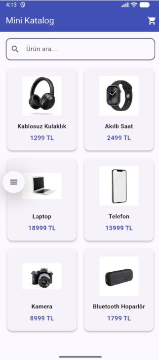
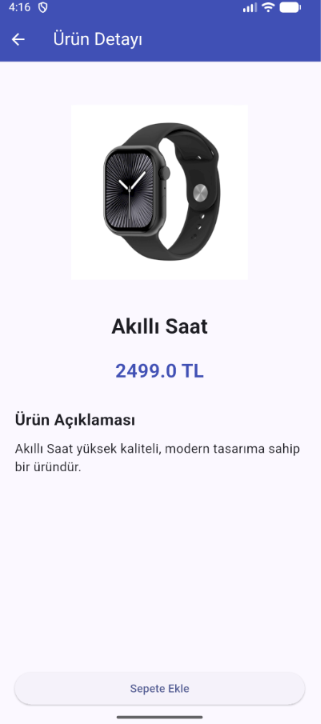
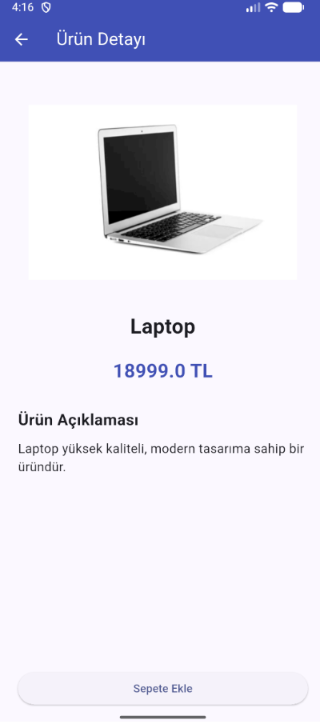
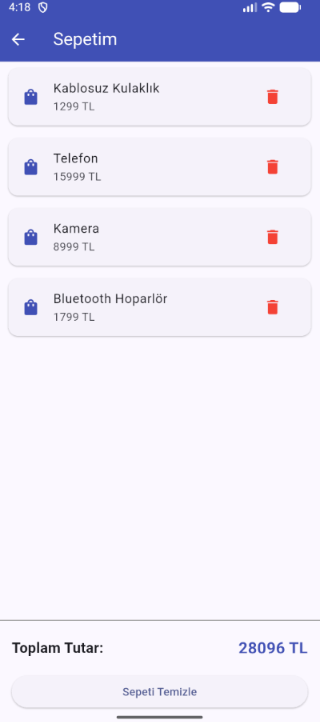

# Mini Katalog Uygulaması 🛍️

Flutter ve Dart kullanılarak geliştirilmiş, ürün listeleme ve
sepet yönetimi özelliklerine sahip bir mobil katalog uygulamasıdır.

## Özellikler

- JSON dosyasından dinamik ürün yükleme
- GridView ile ürün listeleme
- Ürün adına göre arama ve filtreleme
- Ürün detay sayfası
- Ürün fotoğraflarını görüntüleme
- Sepete ürün ekleme ve çıkarma
- Sepet toplam tutarını hesaplama
- Sepeti temizleme
- Navigator ile sayfalar arası geçiş

## Kullanılan Teknolojiler

- Flutter 3.47.5
- Dart 3.13.4
- Material Design
- JSON
- Android Emulator
- Visual Studio Code

## Proje Yapısı

mini_katalog/
├── lib/
│   ├── main.dart
│   ├── cart.dart
│   ├── cart_page.dart
│   ├── product_detail_page.dart
│   └── models/
│       └── product.dart
├── assets/
│   ├── data/
│   │   └── products.json
│   └── images/
└── pubspec.yaml

## Kurulum ve Çalıştırma

1. Flutter SDK'yı bilgisayarınıza kurun.
2. Projeyi GitHub üzerinden bilgisayarınıza indirin.
3. Proje klasöründe terminal açın.
4. Bağımlılıkları yükleyin:

   flutter pub get

5. Android emülatörünü başlatın.
6. Uygulamayı çalıştırın:

   flutter run

## Ekran Görüntüleri

### Ana Sayfa

### Ürün Detay Sayfası

### Sepet Sayfası

## Proje Hakkında

Ürün bilgileri yerel JSON dosyasından okunmaktadır.
Sepet işlemleri uygulama belleğinde simüle edilmektedir.
Gerçek bir ödeme veya e-ticaret altyapısı bulunmamaktadır.
